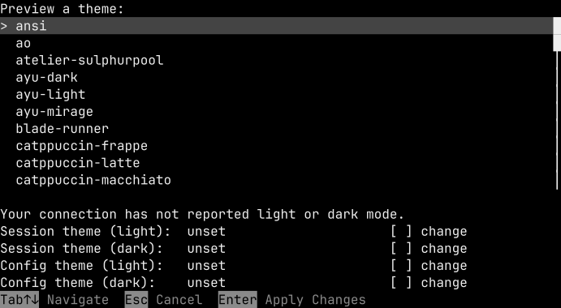

# Zellij Theme Picker

[](https://github.com/fulldecent/zellij-theme-picker/actions/workflows/lint.yml) [](https://github.com/fulldecent/zellij-theme-picker/actions/workflows/build-test.yml)

A window for choosing a Zellij theme. The theme changes as you move through the list. Enter applies the checked boxes and closes the window. Esc puts the previous theme back.



This is a [Zellij](https://zellij.dev/) plugin and supports Zellij 0.45 or newer.

## Try it out

1. Select the latest wasm release and install to your plugins folder:

   ```sh
   name="com.github.fulldecent.zellij-theme-picker.wasm"
   base="https://github.com/fulldecent/zellij-theme-picker/releases/latest/download"
   mkdir -p ~/.config/zellij/plugins
   curl -fL -o ~/.config/zellij/plugins/"$name" "$base/$name"
   curl -fL -o ~/.config/zellij/plugins/"${name}.sigstore.jsonl" "$base/${name}.sigstore.jsonl"
   ```

   If you have the `gh` command, verify the file build attestation:

   ```sh
   gh attestation verify ~/.config/zellij/plugins/"$name" \
     -R fulldecent/zellij-theme-picker \
     --bundle ~/.config/zellij/plugins/"${name}.sigstore.jsonl"
   ```

2. Start a new session (or tab if already in Zellij):

   ```sh
   zellij --layout-string 'layout {
       pane size=1 borderless=true {
           plugin location="tab-bar"
       }
       pane
       pane size=1 borderless=true {
           plugin location="status-bar"
       }
       floating_panes {
           pane name="Themes" focus=true x="10%" y="8%" width="80%" height="75%" {
               plugin location="file:~/.config/zellij/plugins/com.github.fulldecent.zellij-theme-picker.wasm"
           }
       }
   }'
   ```

   Grant `Reconfigure` and `FullHdAccess` when Zellij asks. Click that pane and press `y`.

3. Move through the list. The session theme follows the highlight. Tab moves to the apply boxes. Press Enter to apply the checked boxes and close the window, or Esc to put the previous theme back.

## Usage

Up and down, or `j` and `k`, move through themes. Each theme name is its own row, so `gruvbox-dark` and `gruvbox-light` are separate. Page Up, Page Down, Home, and End move through the list. Moving the pointer onto a row selects that row.

Tab moves between the list and the table. Up and down move through the four rows. Space toggles the focused row.

Moving the highlight previews that name in the current session. The preview sets `theme`, `theme_dark`, and `theme_light` so the palette is visible whichever mode the terminal is in. A blank line sits above the connection sentence. Under that, a table names the session theme and the config theme for light and for dark. Each row has a box labeled change.

- Session theme (light) sets the session `theme_light`.
- Session theme (dark) sets the session `theme_dark`.
- Config theme (light) writes `theme_light` in `config.kdl`.
- Config theme (dark) writes `theme_dark` in `config.kdl`.

`[+]` marks a box that will change. All four boxes start clear. The static `theme` line in the file stays as it was. A session box that is clear is put back to the value from the file. Enter applies the checked boxes and closes the window. Esc puts the three session keys back and leaves `config.kdl` unchanged.

Enter writes each checked line at the root of `~/.config/zellij/config.kdl` when the plugin has read that file. Lines inside a `{` block stay, including a `themes { }` block.

When the plugin has not read `config.kdl`, Enter asks Zellij to save the running config. Zellij rewrites the file and keeps the previous text at `config.kdl.bak`.

Zellij 0.45.1 keeps its config in `~/.config/zellij` under the home directory. The plugin asks for full disk access so it can open that folder, read `config.kdl`, and read `themes/*.kdl`. A `theme_dir` outside `~/.config/zellij/themes` is not listed. Built-in names come from Zellij 0.45.1. `atelier.kdl` defines `atelier-sulphurpool`. The name `default` is included. `default-light` is not part of this version.

The bar at the bottom of the pane shows Tab, up, down, Esc, and Enter. Each of those controls can be clicked.

The picker does not set `explicit_theme_hue`.

## Development

Thank you for taking an interest in improving Zellij Theme Picker.

You will need Git, your platform's native build tools and the Rust tooling described in [rust-toolchain.toml](rust-toolchain.toml). We recommend rustup to manage your rust tooling, but install it using your system package manager rather than the dangerous methods on the rustup website ([ref](#references)).

### Linux

On Ubuntu 22.04+ or Debian 12+:

```sh
sudo apt update
sudo apt install git build-essential rustup
```

On Fedora:

```sh
sudo dnf install git gcc rustup
```

If your distribution has no `rustup` package, follow [other rustup installation methods](https://rust-lang.github.io/rustup/installation/other.html).

### macOS

```sh
xcode-select --install
brew install git rustup
```

Homebrew's `rust` formula is a standalone compiler. It does not honor `rust-toolchain.toml`. Use `rustup` instead.

### Windows

```powershell
winget install --exact --id Git.Git
winget install --exact --id Microsoft.VisualStudio.2022.BuildTools --override "--wait --passive --norestart --add Microsoft.VisualStudio.Workload.VCTools --includeRecommended"
winget install --exact --id Rustlang.Rustup
```

Clone the project and build. On Linux and macOS:

> [!NOTE]
> If you do not require cross compilation, remove the `DYLD_LIBRARY_PATH="..."` part of all commands in this README.

```sh
git clone https://github.com/fulldecent/zellij-theme-picker.git
cd zellij-theme-picker
rustup show
cargo_bin=$(rustup which cargo)
export PATH="$(dirname "$cargo_bin"):$PATH"
export DYLD_LIBRARY_PATH="$(cd "$(dirname "$cargo_bin")/../lib" && pwd)" # macOS only; omit on Linux
cargo check --locked
cargo build --locked
```

In PowerShell:

```powershell
git clone https://github.com/fulldecent/zellij-theme-picker.git
Set-Location zellij-theme-picker
rustup show
$cargo = rustup which cargo
if (-not $cargo) { exit 1 }
$bin = Split-Path $cargo
$env:PATH = "$bin;$env:PATH"
cargo check --locked
cargo build --locked
```

Run this directly with:

```sh
zellij --layout layout/dev.kdl
```

[layout/dev.kdl](layout/dev.kdl) opens a focused floating pane named Themes, with the tab bar and status bar still visible so the preview is easy to see. The plugin path is relative to the directory where you start Zellij.

### Testing

```sh
rustup show
cargo_bin=$(rustup which cargo)
export PATH="$(dirname "$cargo_bin"):$PATH"
export DYLD_LIBRARY_PATH="$(cd "$(dirname "$cargo_bin")/../lib" && pwd)" # macOS only; omit on Linux
cargo test --locked --target "$(rustc -vV | sed -n 's/^host: //p')"
cargo fmt --all -- --check
cargo clippy --all-targets --locked -- -D warnings
cargo build --release --locked
```

`cargo test` runs the Rust tests in `src/`. [tests/snapshot.sh](tests/snapshot.sh) builds the release wasm, runs every script in [shots/](shots/), and exits non-zero unless those bytes match the committed `shots/*.ansi.txt` files. SVG is traced. `diff` does not compare it. The picture is committed as [screenshot.svg](screenshot.svg) at the repository root.

```sh
rustup show
cargo_bin=$(rustup which cargo)
export PATH="$(dirname "$cargo_bin"):$PATH"
export DYLD_LIBRARY_PATH="$(cd "$(dirname "$cargo_bin")/../lib" && pwd)" # macOS only; omit on Linux
cargo install zellij-plugin-snapshot --version 0.2.2 --locked
sh tests/snapshot.sh
```

The host is [Zellij Plugin Snapshot](https://github.com/fulldecent/zellij-plugin-snapshot) 0.2.2. Install that published crate once. `cargo install` compiles it and puts `zellij-plugin-snapshot` on `PATH`. `[dependencies]` would compile it into the plugin wasm. This host is a command, so that field leaves it uninstalled.

`tests/snapshot.sh` passes `--target wasm32-wasip1`. [.cargo/config.toml](.cargo/config.toml) selects that target for a plain `cargo build`. The flag keeps the snapshot build on the plugin wasm if that default is removed.

```sh
npx prettier@latest --check . --write
npx markdownlint-cli@latest "**/*.md" --fix
```

### Releases

Use `fix:`, `feat:` or `BREAKING CHANGE:` in your commit messages. When you push commits to `main`, the release workflow will create a pull request which bumps the version and kicks off a release when you merge.

The [release workflow](.github/workflows/release.yml) uses Release Please's `rust` release type. That pull request bumps the version in [Cargo.toml](Cargo.toml) and [Cargo.lock](Cargo.lock). The package name is `plugin`. `include-component-in-tag: false` keeps the tag `vMAJOR.MINOR.PATCH`. A tag shaped `plugin-v1.2.3` does not pass the publish step.

The released binary is named `com.github.fulldecent.zellij-theme-picker.wasm`. [Build and test](.github/workflows/build-test.yml) builds and tests that wasm, then attests and uploads it. The release also includes `com.github.fulldecent.zellij-theme-picker.wasm.sigstore.jsonl`. The sidecar records the release version. The wasm file name is stable across versions.

In GitHub repository settings, under Actions, General, Workflow permissions, select read and write permissions and check "Allow GitHub Actions to create and approve pull requests". Under General, Releases, enable release immutability. Attestations are available for public repositories. Private repositories require GitHub Enterprise Cloud.

Set the starting tag on the current `main` commit. `v0.0.0` is the version Release Please counts forward from. Run these commands from a clone of this repository. `gh` fills in `{owner}/{repo}` from that clone.

```sh
gh api --method POST repos/{owner}/{repo}/git/refs \
  -f ref="refs/tags/v0.0.0" \
  -f sha="$(gh api repos/{owner}/{repo}/commits/main --jq .sha)"
```

### Maintenance

The project administrator completes these maintenance tasks each month.

1. Identify external Actions in [.github/workflows](./.github/workflows) and update them when it is safe.
1. Review the Rust toolchain in `rust-toolchain.toml`.
1. Review [zellij-plugin-snapshot](https://github.com/fulldecent/zellij-plugin-snapshot) releases. Update every `cargo install zellij-plugin-snapshot --version` line. Regenerate each `shots/*.ansi.txt` and its SVG when the host output changes. Commit [screenshot.svg](screenshot.svg) at the repository root. Commit the other SVG files beside their YAML scripts.

## Project scope

This picker is a window for choosing a theme and applying it to the session or the config file. Zellij’s configuration plugin applies a preset to the running session with `reconfigure`, and a different key asks Zellij to save. See [`presets_screen.rs` at v0.45.1](https://github.com/zellij-org/zellij/blob/v0.45.1/default-plugins/configuration/src/presets_screen.rs). That save rewrites the config file. This picker previews on each move with `reconfigure` and save left false. Enter writes each checked `theme_light` or `theme_dark` line into the `config.kdl` text that was read, so the rest of the file stays. A checked session box changes that session key. When the file was not read, a checked config box uses Zellij’s save. Theme names come from [zellij-utils 0.45.1 theme assets](https://github.com/zellij-org/zellij/tree/v0.45.1/zellij-utils/assets/themes).

In scope:

- List built-in themes and themes in `~/.config/zellij/themes`, one name per row
- Preview the highlighted theme as you move
- Enter writes each checked `theme_light` or `theme_dark` line when `config.kdl` was read, and applies each checked session box
- Esc puts the previous theme back and leaves the file unchanged

Out of scope:

- Scanning a `theme_dir` outside `~/.config/zellij/themes`
- Editing theme colors
- Setting `explicit_theme_hue`
- Layouts do not point at an HTTPS plugin URL

## References

1. We use "Title Case" only for proper nouns, this includes the name of our project.
1. We use a workaround so that rustup works without replacing your system Rust programs ([issue](https://github.com/rust-lang/rustup/issues/5025#issuecomment-6869331794)).
1. This project is built based on [best practices documented in zellij-plugin-template](https://github.com/fulldecent/zellij-plugin-template).
1. This project is built based on [best practices documented in rust-template](https://github.com/fulldecent/rust-template/).
1. This project is built based on [best practices documented in project-template](https://github.com/fulldecent/project-template).
1. Zellij documents themes at [zellij.dev/documentation/themes](https://zellij.dev/documentation/themes.html). Official theme names use hyphens, as in the asset files.
1. Zellij offers another installation method that points your layout configuration to an HTTPS URL. We consider that feature wrong and deprecated.
1. We speak of the official rustup installation recommendation as ugly. [Reported upstream](https://github.com/rust-lang/rust/issues/163468).
1. Render snapshots follow [Zellij Plugin Snapshot](https://github.com/fulldecent/zellij-plugin-snapshot) 0.2.2.
1. This project is released under the [MIT license](./LICENSE.md).
